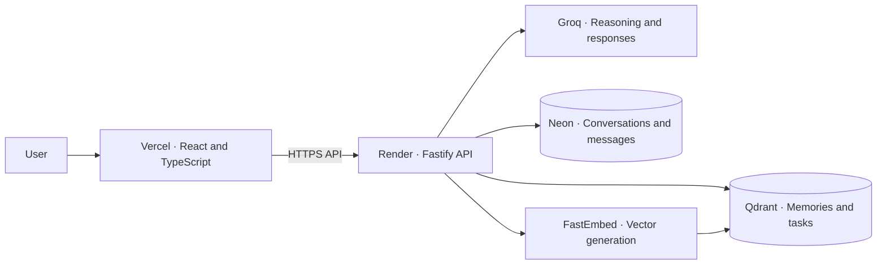
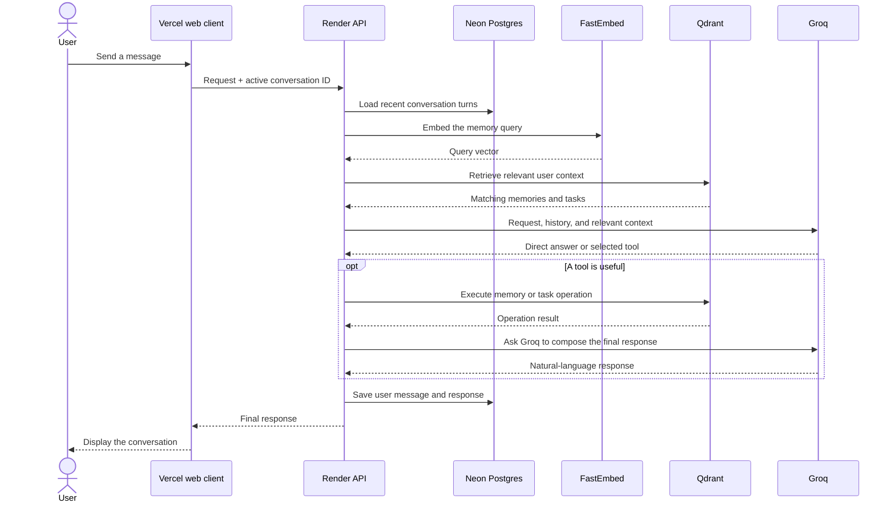

<div align="center">

# ✧ SAGE
### Personal Context & Action Agent

**A conversational assistant that understands your request, retrieves relevant personal context, and responds with Groq.**

[](https://sage-personal-context-agent.vercel.app/)
[](https://github.com/yashasgowdacr/sage-personal-context-agent)


</div>

---

## 🌐 Live application

Open the SAGE web app: **[sage-personal-context-agent.vercel.app](https://sage-personal-context-agent.vercel.app/)**

SAGE combines conversational reasoning, long-term semantic memory, task management, and persistent chat history. Groq interprets each request and chooses whether a memory or task operation is useful. Retrieved Qdrant context is supplied as evidence for Groq to form a relevant answer.

## 🧭 Architecture



| Service | Role in SAGE |
| --- | --- |
| **Vercel** | Hosts the React web client. |
| **Render** | Runs the Node.js API and, in the current combined Docker deployment, the FastEmbed process. |
| **Groq** | Interprets requests, selects agent tools, and writes user-facing responses. |
| **Qdrant Cloud** | Stores and retrieves user-scoped semantic memories and task records. |
| **FastEmbed** | Creates 384-dimensional vectors with `BAAI/bge-small-en-v1.5` for semantic retrieval. |
| **Neon** | PostgreSQL database for persistent conversation messages and recent chats. |

Neon and Qdrant have separate purposes: Neon stores chat history; Qdrant stores searchable personal context and tasks.

## 🔄 Request lifecycle



## ✨ Capabilities

- **Conversational reasoning:** Groq handles natural-language questions and follow-ups.
- **Personal memory:** Save, search, and forget user facts and preferences through Qdrant.
- **Semantic retrieval:** FastEmbed creates vectors used to find relevant memories by meaning.
- **Task management:** Create, list, complete, and cancel personal tasks.
- **Persistent chats:** Neon stores messages and supports recent-chat browsing and reopening.
- **Voice input:** Browser speech recognition can turn spoken prompts into chat messages.
- **Wearable integration:** Omi events can be passed into the agent workflow.
- **API protections:** Signed HttpOnly session cookies, integration API key checks, explicit CORS origin, and request rate limiting.

## 🧰 Technology stack

| Layer | Technologies |
| --- | --- |
| Web | React 19, TypeScript, Vite, CSS |
| API | Node.js, TypeScript, Fastify, Zod |
| Agent reasoning | Groq API, OpenAI-compatible SDK, function tools |
| Persistent chat storage | Neon Serverless Postgres, `@neondatabase/serverless` |
| Vector database | Qdrant Cloud, `@qdrant/js-client-rest` |
| Embedding service | Python 3.11, FastAPI, Uvicorn, FastEmbed, `BAAI/bge-small-en-v1.5` |
| Hosting | Vercel (web), Render (API/container), Neon (Postgres), Qdrant Cloud (vectors) |
| Packaging | Docker |

## 🚀 Deployment

### Vercel — web client

Import the GitHub repository and set:

| Setting | Value |
| --- | --- |
| Root directory | `apps/web` |
| Framework | Vite |
| Build command | `npm run build` |
| Output directory | `dist` |
| Environment variable | `VITE_SAGE_API_URL=https://<your-render-api-domain>` |

Live deployment: **[https://sage-personal-context-agent.vercel.app/](https://sage-personal-context-agent.vercel.app/)**

### Render — combined API and FastEmbed container

The root `Dockerfile` builds the frontend assets and API, then starts the FastEmbed HTTP process and SAGE API in one container.

| Setting | Value |
| --- | --- |
| Service type | Web Service |
| Runtime | Docker |
| Branch | `main` |
| Root directory | Repository root |
| Dockerfile path | `Dockerfile` |
| Health check | `/health` |

Render supplies the public service port through `PORT`. FastEmbed listens internally on `127.0.0.1:8000`. Do not set a fixed `PORT` in the Render dashboard.

### Required Render environment

Set secret values in the Render service dashboard. Do not add private credentials to Vercel environment variables or commit them to Git.

| Variable | Description |
| --- | --- |
| `DATABASE_URL` | Neon pooled connection string for application queries. |
| `GROQ_API_KEY` | Groq API credential. |
| `GROQ_MODEL` | Model name, currently `openai/gpt-oss-20b`. |
| `GROQ_BASE_URL` | `https://api.groq.com/openai/v1`. |
| `QDRANT_URL` | Qdrant Cloud cluster endpoint. |
| `QDRANT_API_KEY` | Qdrant Cloud API credential. |
| `SAGE_SESSION_SECRET` | Secret used to sign browser session cookies. |
| `SAGE_TOOL_API_KEY` | Secret for trusted API integrations. |
| `WEB_ORIGIN` | Exact Vercel origin allowed by CORS. |
| `NODE_ENV` | `production`. |
| `HOST` | `0.0.0.0`. |
| `EMBEDDING_SERVICE_URL` | `http://127.0.0.1:8000` for the combined Docker service. |

The Neon pooled `DATABASE_URL` is for normal application queries. Use `DATABASE_URL_UNPOOLED` for direct administrative or migration workflows.

## 💻 Local development

### Prerequisites

- Node.js and npm
- Python 3.11 or newer
- Groq API key
- Qdrant Cloud URL and API key
- Neon Postgres connection string

Install dependencies from the repository root:

```bash
npm --prefix apps/web install
npm --prefix apps/api install
```

Create or configure `apps/api/.env` with the required server variables. For local development use:

```env
WEB_ORIGIN=http://localhost:3001
EMBEDDING_SERVICE_URL=http://127.0.0.1:8000
```

Start FastEmbed in the first terminal:

```powershell
cd services/embeddings
python -m venv .venv
.\.venv\Scripts\Activate.ps1
pip install -r requirements.txt
python -m uvicorn server:app --host 127.0.0.1 --port 8000
```

Start the API in another terminal:

```bash
cd apps/api
npm run dev
```

The API serves the compiled web app when `apps/web/dist` exists. The local API default is `http://localhost:3001`. To run the Vite development server separately:

```bash
cd apps/web
npm run dev
```

## 🏗️ Build

Build both applications from the repository root:

```bash
npm run build
```

Builds can also be run separately:

```bash
npm run build:web
npm run build:api
```

## 🔌 API overview

| Route | Purpose |
| --- | --- |
| `GET /health` | Service health check. |
| `/auth/*` | Username session login, session check, and logout. |
| `POST /orchestrator/run` | Run a conversational agent request. |
| `/conversations` | List recent chats and load messages for a conversation. |
| `/memory/*` | Save, search, and forget personal memories. |
| `/tasks/*` | Manage tasks. |
| `GET /context` | Load the current user's context for the client. |
| `/omi/*` | Receive and process Omi wearable events. |

The API contract is in [`apps/api/openapi.yaml`](apps/api/openapi.yaml).

## 🔐 Data handling

- Neon stores conversation messages and recent chat records.
- Qdrant stores semantic memories and task records; queries include user filters.
- Groq receives the current request, bounded conversation history, and relevant context needed for reasoning.
- Environment files and secrets should stay out of version control. The `.dockerignore` excludes local environment files from Docker builds.
- Login currently uses a username to select a workspace; it does not verify a real-world identity.

## 📁 Project layout

```text
apps/
  api/                 Fastify API, Groq orchestration, Neon and Qdrant access
  web/                 React and Vite client
services/
  embeddings/          FastAPI and FastEmbed service
Dockerfile             Combined Render container
render.yaml            Render deployment configuration
neon.ts                Neon project configuration
```

---

<div align="center">

Built for personal context that stays useful across conversations.

[Open the live app](https://sage-personal-context-agent.vercel.app/) · [View the source](https://github.com/yashasgowdacr/sage-personal-context-agent)

</div>
